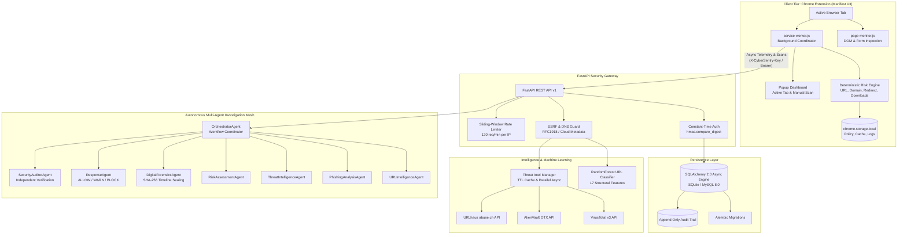
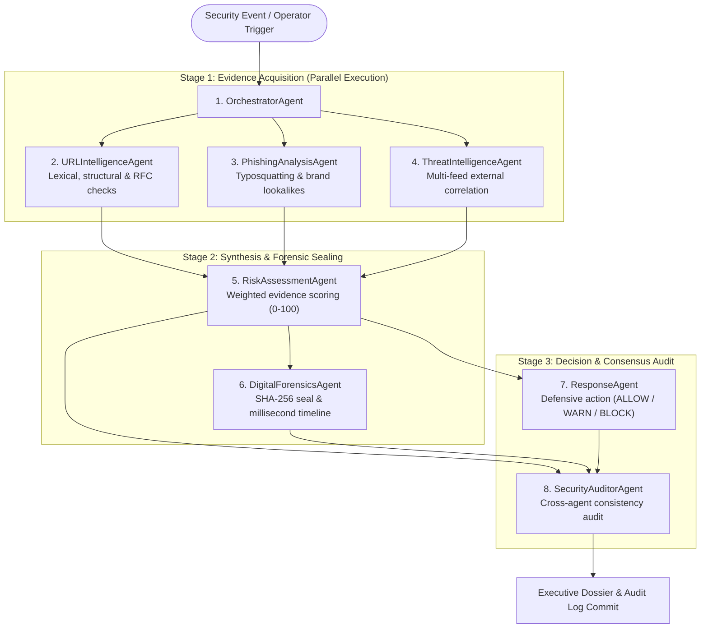

# CyberSentry – Agentic Cyber Defense Platform

> **Enterprise-grade, real-time client-side cybersecurity browser extension powered by an autonomous 8-agent threat investigation mesh, calibrated machine learning classification, and an integrated FastAPI defense backbone.**

[](https://developer.chrome.com/docs/extensions/mv3/intro/)
[](https://fastapi.tiangolo.com)
[](https://python.org)
[](https://docs.sqlalchemy.org)
[](docker-compose.yml)
[](#9-automated-testing--benchmarking)
[](#11-privacy-compliance--security-posture)
[](LICENSE)

---

## Table of Contents

- [1. Executive Summary & Capabilities](#1-executive-summary--capabilities)
- [2. System Architecture & Threat Flow](#2-system-architecture--threat-flow)
- [3. Autonomous 8-Agent Investigation Mesh](#3-autonomous-8-agent-investigation-mesh)
- [4. Calibrated Machine Learning Engine](#4-calibrated-machine-learning-engine)
- [5. External Threat Intelligence Integrations](#5-external-threat-intelligence-integrations)
- [6. Enterprise Hardening & Security Controls](#6-enterprise-hardening--security-controls)
- [7. Repository Structure](#7-repository-structure)
- [8. Quick Start & Setup Guide](#8-quick-start--setup-guide)
  - [Prerequisites](#prerequisites)
  - [Step 1: Install & Load Chrome Extension](#step-1-install--load-chrome-extension)
  - [Step 2: Run FastAPI Backend (Local SQLite Mode)](#step-2-run-fastapi-backend-local-sqlite-mode)
  - [Step 3: Run with Docker Compose (Production MySQL Mode)](#step-3-run-with-docker-compose-production-mysql-mode)
  - [Step 4: Connect Extension to Cloud Mesh](#step-4-connect-extension-to-cloud-mesh)
- [9. Automated Testing & Benchmarking](#9-automated-testing--benchmarking)
  - [Full Test Suite Execution](#full-test-suite-execution)
  - [Interactive Security Simulation Bench](#interactive-security-simulation-bench)
- [10. REST API Specification & Curl Examples](#10-rest-api-specification--curl-examples)
- [11. Configuration & Environment Variables](#11-configuration--environment-variables)
- [12. Privacy Compliance & Security Posture](#12-privacy-compliance--security-posture)
- [13. Chrome Web Store Packaging & Permissions](#13-chrome-web-store-packaging--permissions)
- [14. Troubleshooting & FAQ](#14-troubleshooting--faq)
- [15. License](#15-license)

---

## 1. Executive Summary & Capabilities

**CyberSentry** is a next-generation browser defense system engineered to counter modern social engineering, targeted credential harvesting, deceptive redirects, and zero-day malicious domains.

Unlike traditional extensions that rely solely on static domain blocklists or external APIs (introducing noticeable browsing latency and privacy leakage), CyberSentry utilizes a **hybrid defense-in-depth model**:

1. **Sub-Millisecond Edge Defense (Client-Side):**
   A Manifest V3 extension runs deterministic lexical, structural, and DOM heuristic engines locally inside the browser. It evaluates URLs, redirect cascades, password forms, and downloads with zero network delay and zero credential capture.
2. **Autonomous Cloud Defense Mesh (FastAPI Backend):**
   An enterprise-grade async backend orchestrates an 8-agent autonomous investigation system, queries external threat intelligence feeds in parallel with TTL caching, runs a 17-feature Random Forest ML classifier, and maintains an append-only audit trail.

```
┌────────────────────────────────────────────────────────────────────────┐
│                       CYBERSENTRY DEFENSE SUITE                        │
├───────────────────────────────────┬────────────────────────────────────┤
│         EDGE BROWSER TIER         │        AUTONOMOUS CLOUD TIER       │
│  • Sub-millisecond evaluation     │  • Autonomous 8-agent swarm        │
│  • Typo & homoglyph protection    │  • 17-feature Random Forest ML     │
│  • Insecure password form alert   │  • Multi-feed TI (VT, OTX, abuse)  │
│  • Masqueraded download guard     │  • SSRF & Rebinding shield         │
│  • Zero-credential transmission   │  • Cryptographic forensic timeline │
│  • Autonomous offline operation   │  • Centralized audit trail         │
└───────────────────────────────────┴────────────────────────────────────┘
```

---

## 2. System Architecture & Threat Flow



---

## 3. Autonomous 8-Agent Investigation Mesh

When a high-risk indicator is detected or an operator triggers an investigation from the dashboard, CyberSentry activates an 8-agent swarm coordinated through a bounded finite state machine:



### Swarm Member Responsibilities

| # | Agent Name | Core Responsibilities | Key Outputs |
|---|---|---|---|
| **1** | **`OrchestratorAgent`** | Manages execution lifecycle, enforces bounded timeouts (30s), tracks agent status, compiles executive summary. | `InvestigationState`, Executive Brief |
| **2** | **`URLIntelligenceAgent`** | Analyzes URL grammar, port anomalies, Shannon entropy, excessive subdomains, open redirect query patterns. | Lexical indicators, RFC violations |
| **3** | **`PhishingAnalysisAgent`** | Evaluates Levenshtein distance against high-value targets (Google, PayPal, Microsoft, Apple, Amazon, Banking), flags deceptive subdomains. | Brand lookalike signals, typosquatting risk |
| **4** | **`ThreatIntelligenceAgent`** | Concurrently queries VirusTotal, AlienVault OTX, and URLhaus with TTL caching; normalizes confidence scores. | Feed detection counts, reputation score |
| **5** | **`RiskAssessmentAgent`** | Synthesizes all gathered evidence using category-weighted matrices; computes continuous 0–100 score and risk band. | Final Risk Score, Risk Category |
| **6** | **`DigitalForensicsAgent`** | Computes cryptographic SHA-256 hashes of URL and indicators; generates an immutable, millisecond-accurate timeline. | SHA-256 Hash Seals, Audit Timeline |
| **7** | **`ResponseAgent`** | Derives operational mitigation directives (`ALLOW`, `WARN`, `BLOCK`), remediation steps, and credential warnings. | Recommended Actions, Mitigation Directives |
| **8** | **`SecurityAuditorAgent`** | Independently checks logic for scoring anomalies, conflicting evidence, or hallucinations before database commit. | Audit Verification Flag, Warning Flags |

---

## 4. Calibrated Machine Learning Engine

CyberSentry features an integrated machine learning classifier that detects structural and lexical patterns in URLs that easily evade traditional regex rules:

- **17-Feature Extractor (`backend/app/ml/feature_extractor.py`)**:
  1. `url_length`: Overall character count
  2. `hostname_length`: Length of domain component
  3. `path_length`: Length of URL path
  4. `query_length`: Query string character count
  5. `dot_count`: Dot frequency across entire URL
  6. `hyphen_count`: Hyphen frequency
  7. `at_symbol_count`: `@` character count (embedded credential deception)
  8. `slash_count`: Path separator frequency
  9. `digit_count_host`: Numeric characters in hostname
  10. `digit_ratio_host`: Ratio of numbers to letters in host
  11. `hostname_entropy`: Shannon entropy measuring randomized algorithmic hostnames
  12. `is_ip_address`: Binary flag for raw IPv4/IPv6 hostnames
  13. `is_https`: Protocol encryption verification
  14. `subdomain_count`: Hierarchy depth
  15. `has_brand_keyword`: Brand matching flags (login, secure, verify, account)
  16. `has_suspicious_tld`: Detection of high-abuse TLDs (`.xyz`, `.top`, `.tk`, etc.)
  17. `has_auth_path`: Authentication path flags (`/signin`, `/webscr`, `/checkout`)
- **Classifier (`backend/app/ml/model.py`)**:
  Pre-trained calibrated `RandomForestClassifier` outputting continuous probabilities `[0.0, 1.0]` mapped to confidence intervals (`High`, `Medium`, `Low`).
- **Evaluation Pipeline (`backend/app/ml/trainer.py`)**:
  Includes stratified 70/30 train/test evaluation with precision, recall, F1, and confusion matrix validation.

---

## 5. External Threat Intelligence Integrations

CyberSentry connects to leading global threat intelligence feeds through a unified asynchronous adapter layer:

| Intelligence Provider | Query Endpoints | Indicators Evaluated | Free Tier Supported |
|---|---|---|:---:|
| **VirusTotal** | `/api/v3/urls`, `/api/v3/domains` | URLs, Domains, Malicious Engine Counts | Yes (API Key) |
| **AlienVault OTX** | `/api/v1/indicators/domain/general` | Domains, Threat Pulses, Adversary Tags | Yes (OTX Key) |
| **URLhaus (abuse.ch)**| `/v1/url/`, `/v1/host/` | URLs, Hosts, Active Malware Payloads | Yes (Public / Auth Key) |

### Key Resilience Features
- **Graceful Fallback:** If API keys are unset or external APIs experience rate limits/timeouts, CyberSentry flags provider status as `unconfigured` or `error` and seamlessly proceeds with local heuristics and ML. **Browsing is never blocked by external downtime.**
- **TTL Cache Layer:** In-memory cached responses (default: 3600s) eliminate duplicate outbound API queries and conserve API rate allowances.

---

## 6. Enterprise Hardening & Security Controls

CyberSentry applies strict defense-in-depth principles across its full stack:

1. **Server-Side Request Forgery (SSRF) Guard (`backend/app/security/ssrf_guard.py`)**:
   Deep URL scanning strictly prohibits requests targeting:
   - Loopback ranges (`127.0.0.0/8`, `localhost`, `::1`)
   - RFC 1918 private subnets (`10.0.0.0/8`, `172.16.0.0/12`, `192.168.0.0/16`)
   - Link-local and Carrier-Grade NAT (`169.254.0.0/16`, `100.64.0.0/10`)
   - Cloud instance metadata endpoints (`169.254.169.254`, `metadata.google.internal`)
   - DNS rebinding validation via runtime socket IP resolution
2. **Constant-Time Authentication (`backend/app/security/auth.py`)**:
   API keys submitted via `X-CyberSentry-Key`, `X-SentinelX-Key` (legacy compatibility), or `Authorization: Bearer` are compared using `hmac.compare_digest` to eliminate side-channel timing attacks.
3. **CSV Formula Injection Sanitization (`extension/history/history.js`)**:
   Exported telemetry logs automatically prepend a single quote (`'`) to any cell starting with formula execution characters (`=`, `+`, `-`, `@`, `\t`, `\r`) to defend against spreadsheet DDE code execution exploits.
4. **Sliding-Window Rate Limiter (`backend/app/security/rate_limiter.py`)**:
   Enforces configurable throughput boundaries (default: 120 req/min per IP) to prevent denial of service and API abuse.
5. **Append-Only Security Audit Trail (`backend/app/models/audit_log.py`)**:
   Every high-risk detection, investigation, and administrative configuration modification is written to an immutable audit table with timestamp, client IP, and actor identity.

---

## 7. Repository Structure

```
Extension/
├── extension/                         # Chrome Extension (Manifest V3)
│   ├── manifest.json                  # Extension permissions & entrypoints
│   ├── assets/                        # SVG vectors & branding assets
│   ├── icons/                         # 16px, 48px, 128px toolbar icons
│   ├── background/
│   │   └── service-worker.js          # Navigation monitor, downloads, backend sync
│   ├── content/
│   │   └── page-monitor.js            # Passive DOM, form & password inspection
│   ├── detection/
│   │   ├── domain-analyzer.js         # Subdomain depth, IP hostnames, Punycode
│   │   ├── url-scanner.js             # Scheme, query parameters, length checks
│   │   ├── phishing-detector.js       # Brand lookalikes, typosquatting distances
│   │   ├── redirect-monitor.js        # Multi-hop cascades & cross-domain tracking
│   │   └── risk-engine.js             # Deterministic 0-100 client scoring
│   ├── storage/
│   │   └── storage-manager.js         # chrome.storage.local interface
│   ├── notifications/
│   │   └── notification-manager.js    # Chrome desktop notifications with cooldown
│   ├── popup/                         # Extension Toolbar Popup Dashboard
│   │   ├── popup.html / css / js      # Active tab scan, manual scan, quick actions
│   ├── history/                       # Audit Trail & Log Viewer
│   │   ├── history.html / css / js    # Search, filters, safe CSV export
│   └── settings/                      # Preferences & Policy UI
│       ├── settings.html / css / js   # Allowlist/blocklist, cloud mesh config
│
├── backend/                           # FastAPI Cloud Defense Backbone
│   ├── Dockerfile                     # Production container specification
│   ├── requirements.txt               # Locked Python dependencies
│   ├── .env.example                   # Environment configuration template
│   ├── alembic.ini                    # Alembic migration configuration
│   ├── alembic/                       # Schema version control
│   └── app/
│       ├── main.py                    # Application lifecycle & FastAPI root
│       ├── core/                      # Config, logging, database, error handlers
│       ├── models/                    # SQLAlchemy 2.0 async ORM models
│       ├── schemas/                   # Pydantic v2 validation models
│       ├── security/                  # Constant-time auth, SSRF guard, rate limiter
│       ├── repositories/              # Async repository data-access layer
│       ├── services/                  # Business services (scans, telemetry, investigations)
│       ├── intelligence/              # Adapters for VirusTotal, AlienVault, URLhaus
│       ├── ml/                        # 17-feature extractor, Random Forest model, trainer
│       ├── agents/                    # Autonomous 8-agent swarm implementation
│       │   ├── orchestrator.py        # Master workflow state machine
│       │   ├── url_intelligence.py    # URL lexical & structural agent
│       │   ├── phishing_analysis.py   # Brand lookalike & typosquatting agent
│       │   ├── threat_intelligence.py # External feed aggregation agent
│       │   ├── risk_assessment.py     # Multi-signal evidence synthesis agent
│       │   ├── digital_forensics.py   # Cryptographic SHA-256 timeline agent
│       │   ├── response_agent.py      # Mitigation & recommendation agent
│       │   ├── security_auditor.py    # Independent consensus audit agent
│       │   └── schemas.py             # Agent data models & state structures
│       ├── api/v1/                    # REST endpoints (health, scans, telemetry...)
│       └── tests/                     # 30-case Pytest automated test suite
│
├── test-pages/
│   └── simulation.html                # Interactive security test bench (offline)
├── tests/
│   └── run-tests.mjs                  # Client-side 42-assertion test runner
├── docker-compose.yml                 # Multi-container MySQL 8.0 & FastAPI stack
├── package.json                       # Extension scripts and test orchestration
├── pytest.ini                         # Backend test suite configuration
└── README.md                          # Master project documentation
```

---

## 8. Quick Start & Setup Guide

### Prerequisites
- **Google Chrome** (v109+ with Manifest V3 support)
- **Python 3.11+** (Python 3.11, 3.12, or 3.13)
- **Node.js 18+** (for running frontend tests and icon generation)
- *(Optional)* **Docker & Docker Compose** (for production MySQL deployment)

---

### Step 1: Install & Load Chrome Extension

1. Open Google Chrome and navigate to:
   ```text
   chrome://extensions/
   ```
2. Enable **Developer mode** via the toggle switch in the upper-right corner.
3. Click the **Load unpacked** button.
4. Select the `extension/` directory inside this repository:
   ```text
   <path-to-repository>/extension
   ```
5. The CyberSentry shield icon will appear in your Chrome toolbar. Click the puzzle icon and pin **CyberSentry** for easy access.

---

### Step 2: Run FastAPI Backend (Local SQLite Mode)

To start the backend with zero external dependencies using local asynchronous SQLite:

```bash
# 1. From repository root, install backend dependencies
pip install -r backend/requirements.txt

# 2. Launch the FastAPI server from the repository root
uvicorn backend.app.main:app --host 127.0.0.1 --port 8000 --reload
```

The database (`sentinelx.db` or `cybersentry.db`) is automatically initialized upon startup. Verify the backend is operational:
- **Interactive OpenAPI Documentation:** [http://127.0.0.1:8000/docs](http://127.0.0.1:8000/docs)
- **Health Check Endpoint:** [http://127.0.0.1:8000/health](http://127.0.0.1:8000/health)

---

### Step 3: Run with Docker Compose (Production MySQL Mode)

For a production-ready setup with MySQL 8.0 and persistent database storage:

```bash
# From the repository root
docker-compose up -d
```

This launches:
- **`sentinelx-db`**: MySQL 8.0 on port `3306` with persistent storage volume
- **`sentinelx-backend`**: FastAPI application on port `8000` with automated health checks

---

### Step 4: Connect Extension to Cloud Mesh

1. Click the **CyberSentry** icon in your Chrome toolbar.
2. Click the **Settings (gear icon)** in the top right of the popup.
3. In the **Backend Server Integration** section, configure:
   - **Backend API Endpoint:** `http://127.0.0.1:8000`
   - **API Key:** `sentinelx-client-dev-key`
   - **Enable Cloud Threat Intelligence Enrichment:** `ON`
   - **Send Anonymous Security Telemetry:** `ON`
4. Click **Save Configuration**.
5. The cloud status badge in the popup will instantly turn green and display **Cloud: Online**.

---

## 9. Automated Testing & Benchmarking

CyberSentry maintains strict test coverage across both client and server tiers (**72 out of 72 automated assertions pass**).

### Full Test Suite Execution

Run all test suites with a single command from the project root:

```bash
# Run both Extension (Node) and Backend (Pytest) test suites
npm run test:all
```

Or run each tier independently:

```bash
# 1. Frontend Extension Test Suite (42 assertions across 16 scenarios)
npm test

# 2. Backend Platform Pytest Suite (30 test cases)
python -m pytest -v
```

```
================================================================
   CyberSentry Automated Test Suite Status: 72/72 PASSING
================================================================
✓ Frontend Extension: 16 scenarios, 42 assertions PASS (Node.js)
✓ Backend Platform:   30 unit & end-to-end tests PASS (Pytest)
```

---

### Interactive Security Simulation Bench

CyberSentry includes a self-contained, harmless local test environment for live security evaluation.

1. In Chrome, open the local simulation file:
   ```text
   file:///c:/Users/divya/OneDrive/Desktop/Projects/Extension/test-pages/simulation.html
   ```
2. **Vector 1: Credential Harvesting Inspection**
   - Contains a simulated login form configured to post to an external IP destination.
   - CyberSentry flags the password field structure and destination mismatch.
3. **Vector 2: Masqueraded Download Inspector**
   - Click **Download Safe Document (.txt)**: Extension evaluates it as benign.
   - Click **Trigger Masqueraded Download (.pdf.exe)**: Extension intercepts the double-extension masquerade and raises a high-risk security alert.
4. **Vector 3: Manual Evaluation Bench**
   - Click the CyberSentry popup, switch to the **Manual Scan** tab, and test the provided sample URLs (lookalike domains, Punycode, raw IP with login paths, open redirects).

---

## 10. REST API Specification & Curl Examples

Interactive OpenAPI/Swagger documentation is available at `http://127.0.0.1:8000/docs`.

### Authentication
All protected endpoints require either:
- Header: `X-CyberSentry-Key: <your-api-key>` (or `X-SentinelX-Key: <your-api-key>`)
- Header: `Authorization: Bearer <your-api-key>`

### 1. Perform Deep URL Scan (ML + Threat Intel)
```bash
curl -X POST http://127.0.0.1:8000/api/v1/scans/url \
  -H "Content-Type: application/json" \
  -H "X-CyberSentry-Key: sentinelx-client-dev-key" \
  -d '{"url": "https://paypa1-security-verify.xyz/login"}'
```

**Example Response:**
```json
{
  "scanId": "scn_a8f3b2019c4d",
  "url": "https://paypa1-security-verify.xyz/login",
  "domain": "paypa1-security-verify.xyz",
  "riskScore": 92,
  "category": "Critical Risk",
  "mlPrediction": {
    "maliciousProbability": 0.941,
    "confidence": "High"
  },
  "threatIntel": {
    "status": "completed",
    "positives": 4
  },
  "indicators": [
    {
      "id": "TYPOSQUATTING_LOOKALIKE",
      "severity": "CRITICAL",
      "description": "Domain mimics PayPal using Levenshtein distance substitution"
    }
  ]
}
```

### 2. Trigger Autonomous 8-Agent Investigation
```bash
curl -X POST http://127.0.0.1:8000/api/v1/investigations/trigger \
  -H "Content-Type: application/json" \
  -H "X-CyberSentry-Key: sentinelx-client-dev-key" \
  -d '{"targetUrl": "https://paypa1-security-verify.xyz/login"}'
```

### 3. Retrieve Full Investigation Dossier
```bash
curl -X GET http://127.0.0.1:8000/api/v1/investigations/{investigation_id} \
  -H "X-CyberSentry-Key: sentinelx-client-dev-key"
```

### 4. Ingest Extension Security Telemetry
```bash
curl -X POST http://127.0.0.1:8000/api/v1/telemetry/events \
  -H "Content-Type: application/json" \
  -H "X-CyberSentry-Key: sentinelx-client-dev-key" \
  -d '{
    "eventType": "DOMAIN_RISK_DETECTED",
    "domain": "paypa1-security-verify.xyz",
    "riskScore": 92,
    "category": "Critical Risk",
    "indicators": ["TYPOSQUATTING_LOOKALIKE", "SUSPICIOUS_TLD"]
  }'
```

---

## 11. Configuration & Environment Variables

Create a `.env` file in `backend/` or configure the environment variables below:

| Environment Variable | Default Value | Description |
|---|---|---|
| `ENVIRONMENT` | `development` | Deployment mode (`development`, `production`, `test`) |
| `APP_NAME` | `CyberSentry Cyber Defense Platform` | Application title reported in logs & OpenAPI |
| `SENTINELX_API_KEY` | `sentinelx-client-dev-key` | Master client-to-backend authentication secret |
| `SECRET_KEY` | *(Random 32-byte string)* | Cryptographic secret for signing tokens |
| `DATABASE_URL` | `sqlite+aiosqlite:///./sentinelx.db` | Async SQLAlchemy database connection string |
| `DB_POOL_SIZE` | `10` | SQLAlchemy connection pool size (MySQL mode) |
| `RATE_LIMIT_PER_MINUTE` | `120` | Max allowed requests per client IP per minute |
| `VIRUSTOTAL_API_KEY` | `""` | VirusTotal v3 API key (optional) |
| `ALIENVAULT_OTX_API_KEY` | `""` | AlienVault OTX key (optional) |
| `URLHAUS_AUTH_KEY` | `""` | abuse.ch URLhaus key (optional) |
| `THREAT_INTEL_CACHE_TTL_SECONDS` | `3600` | In-memory cache duration for threat queries |
| `AGENT_TIMEOUT_SECONDS` | `10.0` | Individual agent execution bounded timeout |

---

## 12. Privacy Compliance & Security Posture

CyberSentry is built under a strict **Zero-Trust, Privacy-First Architecture**:

- **Zero Credential Capture:** The content script (`page-monitor.js`) analyzes form tags and DOM attributes. It **never reads, logs, or transmits keystrokes, password values, or input field contents**.
- **Sanitized Telemetry:** Telemetry payloads contain only the domain, sanitized URL path, triggered heuristic rule IDs, and calculated risk scores. Query parameter values and authentication tokens are stripped client-side.
- **Autonomous Local Defense:** In the event that backend connectivity is lost or disabled, the browser extension continues to enforce 100% of its deterministic detection rules locally.
- **Anti-Exploitation CSV Sanitization:** Exported audit records sanitize spreadsheet triggers (`=`, `+`, `-`, `@`) to eliminate CSV injection (Formula Injection) attacks.

---

## 13. Chrome Web Store Packaging & Permissions

### Permissions Justification
When submitting to the Chrome Web Store or auditing enterprise permissions:

| Permission | Technical Requirement & Justification |
|---|---|
| `storage` | Stores user preferences, allowlists, blocklists, and cached scan metrics locally. |
| `tabs` / `activeTab` | Retrieves the active tab URL and domain to execute real-time heuristic security audits. |
| `webNavigation` | Monitors navigation sequences and redirect chains to catch multi-hop deception campaigns. |
| `notifications` | Alerts the user immediately when high-risk or critical threats are encountered. |
| `downloads` | Inspects download metadata (filename and extension) to catch masqueraded executables (`.pdf.exe`). |
| `host_permissions` | Required to perform DOM analysis across web pages visited by the user. |

---

## 14. Troubleshooting & FAQ

<details>
<summary><strong>Q: The extension badge displays "Local Mode" instead of "Cloud: Online". How do I connect?</strong></summary>

1. Ensure the FastAPI backend is running on `http://127.0.0.1:8000`.
2. Check that the port is accessible by opening `http://127.0.0.1:8000/health` in your browser.
3. Open the extension Settings, verify the API URL is `http://127.0.0.1:8000` and API Key matches `sentinelx-client-dev-key`.
4. Click **Save Configuration**.
</details>

<details>
<summary><strong>Q: Do I need paid API keys for VirusTotal or AlienVault to run CyberSentry?</strong></summary>

No. CyberSentry functions completely out of the box with zero external API keys. Both free public API keys and unconfigured modes are supported. When external feeds are unconfigured, CyberSentry uses its local deterministic engine and 17-feature Random Forest ML classifier.
</details>

<details>
<summary><strong>Q: How do I run migrations when switching to MySQL?</strong></summary>

Update `DATABASE_URL` in `.env` to point to your MySQL instance, then run:
```bash
alembic upgrade head
```
</details>

---

## 15. License

Distributed under the **Apache-2.0 License**. See `LICENSE` for further details.
